

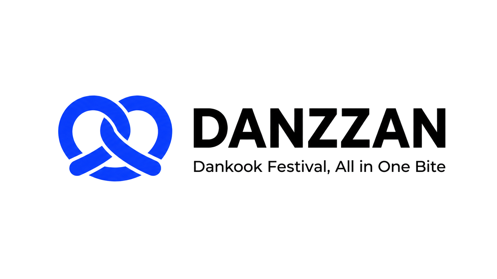

 

[**Frontend Repository**](https://github.com/DKU-Dan-Zzan/Danzzan-FE)
&nbsp;·&nbsp;
[**Backend Repository**](https://github.com/DKU-Dan-Zzan/Danzzan-BE)

**Production** · `https://danfesta2026.yaaksok.com/`  
2026 단국대학교 봄 축제 & 가을 축제 기간 실제 운영 · 현재 서비스 종료

 

## 단국 축제, 하나로 즐겨라

**공연 · 부스 · 티켓 · 공지 — 단국대 봄 축제를 위해 직접 만들고, 실제로 운영한 서비스**

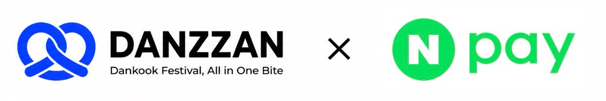
🎓 $\textcolor{#04c75b}{\textbf{대학 최초 네이버페이 페이스사인 도입}}$ 네이버 페이스사인 얼굴 인증 연동 · 티켓 양도·대리 입장 원천 차단

---

## 팀 소개

<table>
<tr>
  <th align="center">이름</th>
  <th align="center">학번</th>
  <th>역할</th>
</tr>
<tr>
  <td align="center" nowrap>강하늘</td>
  <td align="center">32230120</td>
  <td>관리자 페이지 전반 설계 및 개발, 긴급·일반 공지사항 등록·수정·삭제 기능, 광고 배너 등록 및 노출 순서 관리, 관리자 권한 분리 및 접근 제어 설계</td>
</tr>
<tr>
  <td align="center" nowrap>박지우</td>
  <td align="center">32211862</td>
  <td>Redis 대기열 및 Lua Script 원자적 선착순 처리로 티켓 예매 시스템 개발, Spring Security 기반 JWT 회원 인증 체계 설계, 로그인·회원가입 구현 </td>
</tr>
<tr>
  <td align="center" nowrap>박주희</td>
  <td align="center">32221902</td>
  <td>Kafka 기반 비동기 티켓 발급 파이프라인 및 대기열 시스템 구현, 팔찌 배부 현황 실시간 조회 및 관리 플랫폼 개발, 회원 탈퇴·비밀번호 재설정 개발</td>
</tr>
<tr>
  <td align="center" nowrap>조하은</td>
  <td align="center">32234364</td>
  <td>축제 메인 홈 화면(포스터·라인업·현재 공연 섹션), 캠퍼스 지도 기반 부스맵(날짜·단과대 필터), 지도 편집 기능, 공연 일정 타임테이블 개발</td>
</tr>
</table>

---

## 어떤 서비스인가요?

공지는 인스타그램, 티켓은 오픈카톡, 부스 위치는 에브리타임 — 축제 정보는 늘 여러 채널에 흩어져 있었습니다.

기존 축제 앱들도 공지나 타임테이블 정도는 제공했지만, **공지부터 티켓팅까지 하나의 서비스에서 함께 처리하는 경우는 없었습니다.** 
예매는 여전히 오픈카톡이나 외부 링크로 빠져나갔고, 운영진은 엑셀·구글폼으로 예매 내역을 따로 관리해야 했습니다.

학생들은 채널을 옮겨 다니다 티켓 링크를 놓쳤고, 운영진은 같은 내용을 여러 곳에 반복 게시하면서 DM·댓글로 개별 문의까지 대응해야 했습니다. 
예매 내역과 실수령 현황이 실시간으로 맞지 않아 현장에서 혼선도 잦았습니다.

DANZZAN에서는 학생들이 공연 일정과 부스 위치를 확인하고, 티켓을 예매·조회하며, 공지사항까지 한 번에 확인할 수 있습니다. 
운영진은 관리자 페이지에서 축제 콘텐츠를 관리하고, 예매 내역과 팔찌 배부 현황을 확인하며 현장 수령 처리를 진행할 수 있습니다.

여기에 $\textcolor{#04c75b}{\textbf{네이버 페이와의 협업}}$이 더해졌습니다. 
네이버 페이스사인(얼굴 인증)을 입장 시 신원 확인에 연동해, 티켓 양도나 대리 입장을 구조적으로 차단했습니다. 실제로 비윤리적 양도·도용 사례는 0%에 수렴했습니다.

2026년 5월 봄축제에서 실제 운영한 뒤, 같은 해 9월 가을축제에 맞춰 서비스를 개선해 다시 운영했습니다. 
한국어·영어 전환과 콘텐츠 번역 기능을 추가해 축제 정보를 영어로도 확인할 수 있도록 했으며, 가을축제 고유의 로고·포스터와 브랜딩을 화면에 반영했습니다.

총학생회와 직접 미팅하며 요구사항을 수집하고, 하나의 앱으로 해결했습니다.

**공연, 부스, 티켓, 공지 전부 한 앱에서.**

---

## 시연 영상 (2026년 상반기 기준)

<table>
<tr>
<td valign="top" width="55%">

 

</td>
<td valign="top">

| 타임스탬프 | |
|---|---|
| `0:00` | 회원가입 |
| `1:28` | 비밀번호 재설정 |
| `2:11` | 웹앱(PWA) 설치 |
| `2:20` | 홈화면 소개 |
| `3:08` | 부스맵 기능 |
| `4:23` | 타임테이블 기능 |
| `4:28` | 공지사항 & 긴급공지 기능 |
| `5:12` | 로그인 & 티켓팅 |
| `6:13` | 내정보 기능 |
| `6:43` | 관리자 — 운영데이터 관리 |
| `10:16` | 관리자 — 팔찌 배부 |

</td>
</tr>
</table>

---

## 2026년 상반기 최종 보고서

---

## 서비스 화면

> 봄축제 운영 버전의 화면입니다. 가을축제에서 추가·개선한 화면은 다음 섹션에서 소개합니다.

**사용자 화면**

| 홈 | 타임테이블 | 부스맵 |
|:---:|:---:|:---:|
| 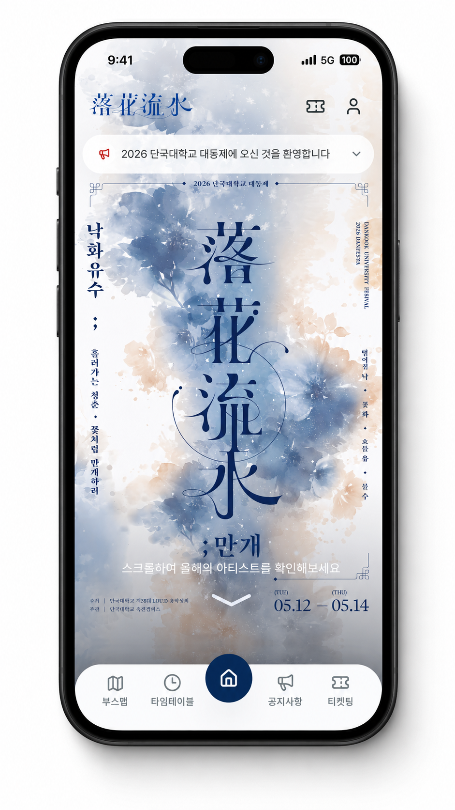 | 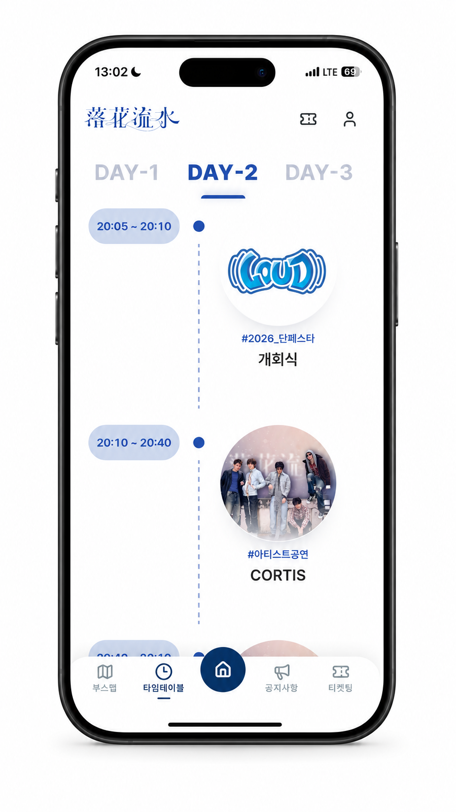 | 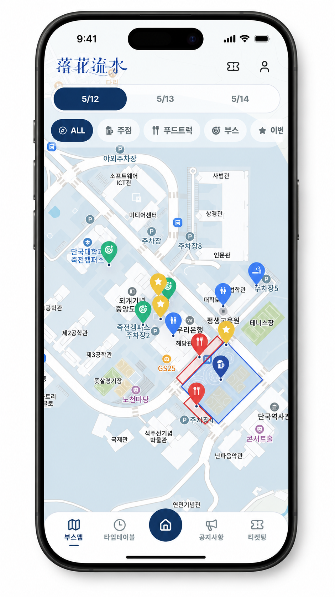 |

| 티켓팅 대기열 | 내 티켓 | 공지사항 |
|:---:|:---:|:---:|
| 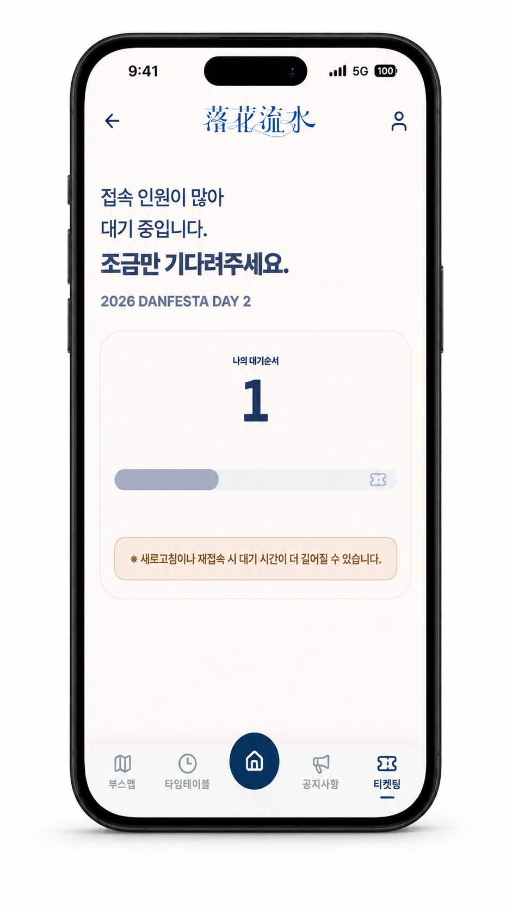 | 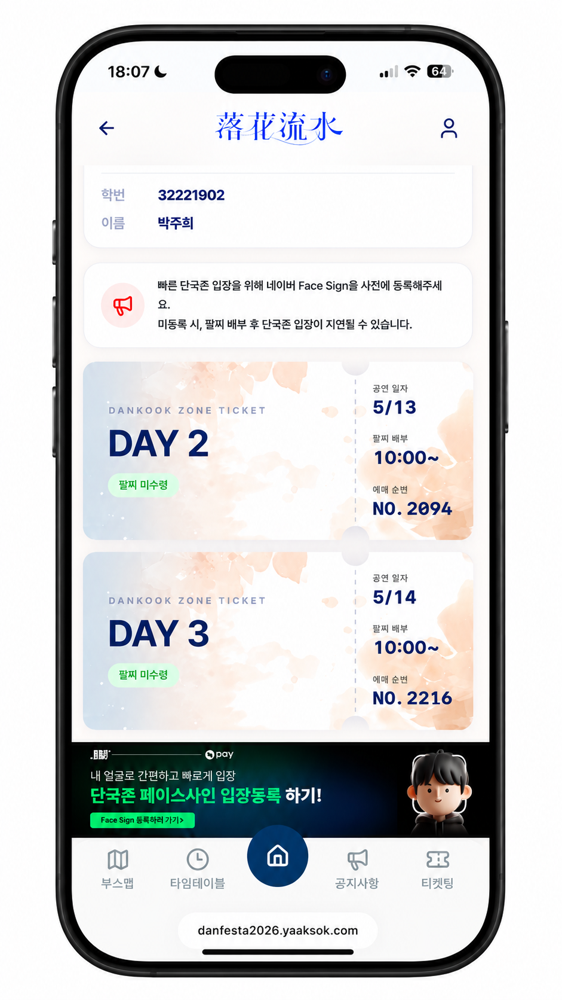 | 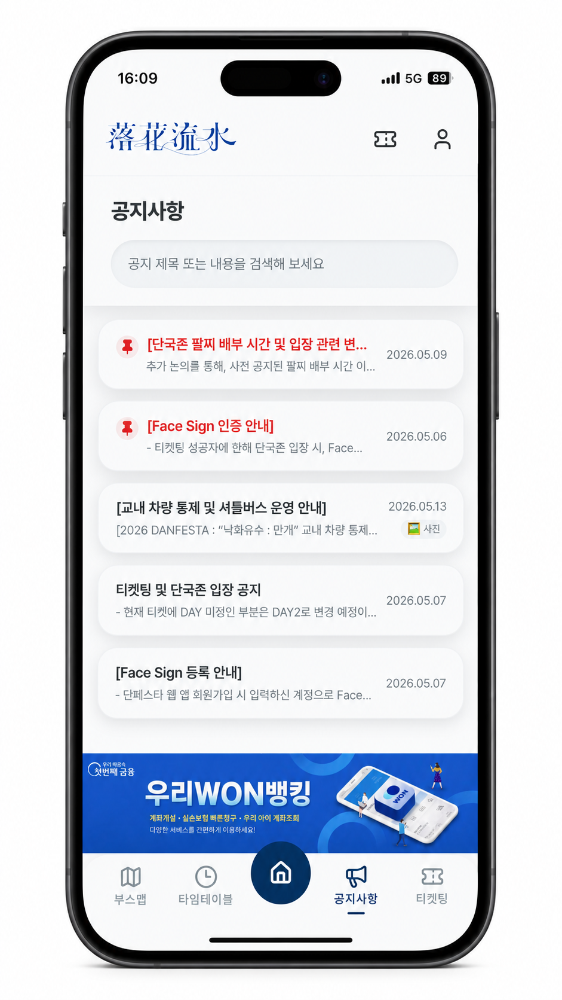 |

**회원가입**

| 1단계 | 2단계 | 3단계 |
|:---:|:---:|:---:|
| 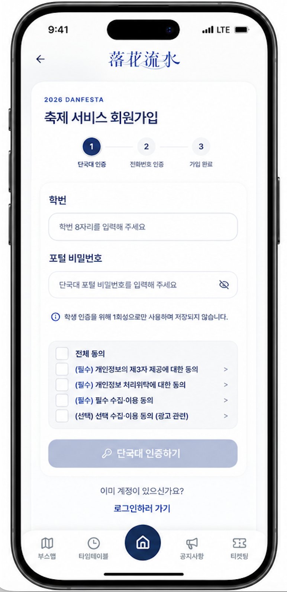 | 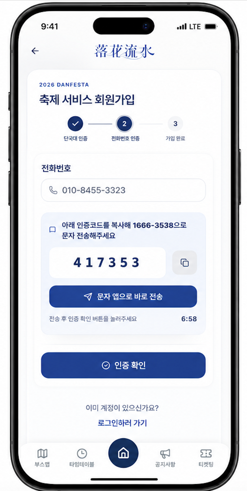 | 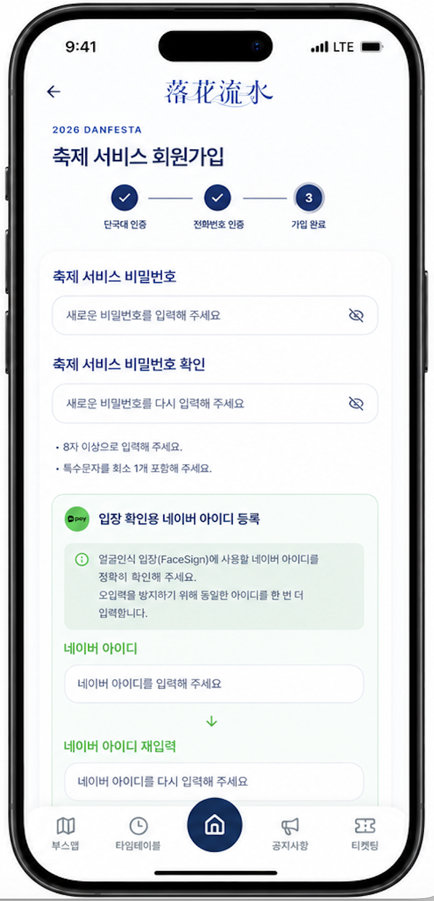 |

**관리자 화면**

| 공지 관리 | 광고 등록 | 팔찌 배부 |
|:---:|:---:|:---:|
| 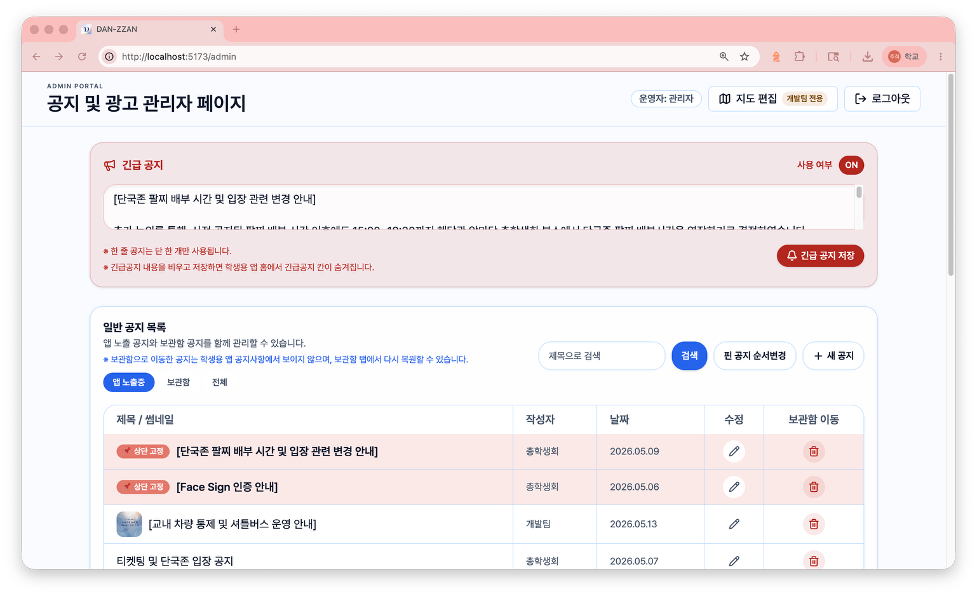 | 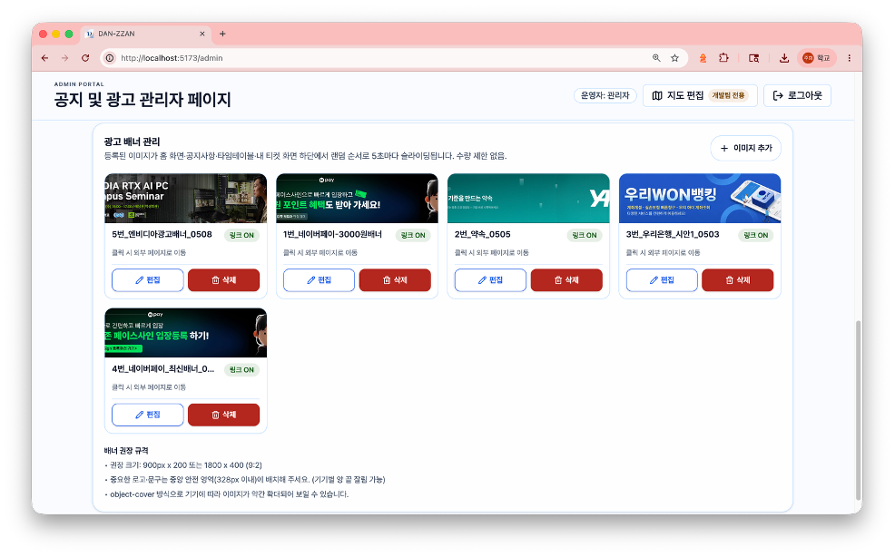 | 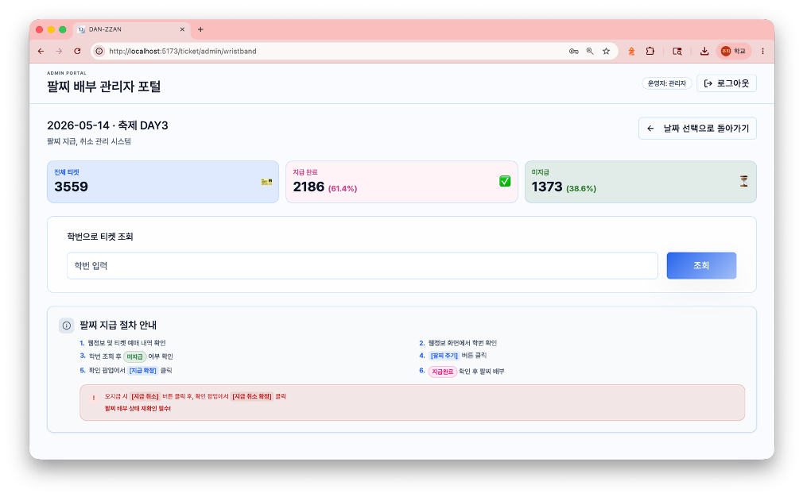 |

---

## 가을축제 — 브랜딩과 번역 기능 확장

봄축제 운영 이후, 가을축제의 분위기를 담은 화면과 영어로 축제 정보를 확인할 수 있는 기능을 더해 서비스를 다시 운영했습니다.

### 1. 가을축제 고유 브랜딩 반영

가을축제 **LEGEND**의 로고와 포스터를 서비스에 반영했습니다. 홈 화면뿐 아니라 타임테이블에서도 축제의 시각적 정체성이 이어지도록 구성했습니다.

| 봄축제 홈 | 가을축제 홈 | 가을축제 타임테이블 |
|:---:|:---:|:---:|
|  |  |  |
| 봄축제 운영 버전 | 가을축제 로고·포스터 반영 | 주요 화면에 브랜딩 적용 |

### 2. 한국어·영어 전환 및 콘텐츠 번역

한국어와 영어를 선택해 화면을 이용할 수 있도록 언어 전환 기능을 추가했습니다. 메뉴와 버튼 등의 UI 문구뿐 아니라, 공지사항·부스·공연 정보 등 운영진이 등록하는 텍스트에도 영어 번역을 적용했습니다.

| 한국어 공지 | 영어 공지 |
|:---:|:---:|
|  |  |
| 한국어 제목과 본문 | 동일한 공지의 영어 제목과 본문 |

| 구분 | 구현 내용 |
|:---|:---|
| **UI 언어 전환** | 한국어·영어 문자열 사전을 분리해 선택한 언어의 문구 표시 |
| **콘텐츠 번역** | DeepL을 연동해 운영 콘텐츠의 한국어 텍스트를 영어로 번역 |
| **운영진 수정** | 관리자가 영문 내용을 직접 입력하거나 보정할 수 있도록 지원 |
| **번역 누락 대응** | 영문이 없는 항목은 한국어 원문을 표시 |

---

### 3. 관리자 번역 관리

운영진이 한국어로 콘텐츠를 입력하면 영어 입력란에 번역 결과가 자동으로 채워지도록 구성했습니다. 자동 번역된 내용을 확인하고, 축제 고유 명칭이나 안내 표현은 직접 수정할 수 있습니다.

| 한국어 콘텐츠 입력 | 영어 번역 자동 입력 |
|:---:|:---:|
|  |  |
| 운영진이 한국어 제목과 본문 입력 | 자동 번역된 영문 확인 및 수정 |

| 기능 | 내용 |
|:---|:---|
| **자동 번역** | 한국어로 등록한 운영 콘텐츠에 DeepL 기반 영어 번역 적용 |
| **번역 확인·수정** | 한국어 원문과 영문 내용을 함께 확인하고, 필요한 표현을 직접 수정 |
| **수동 번역 보호** | 관리자가 직접 수정한 영문은 자동 번역으로 덮어쓰지 않도록 처리 |

---

## 시스템 아키텍처

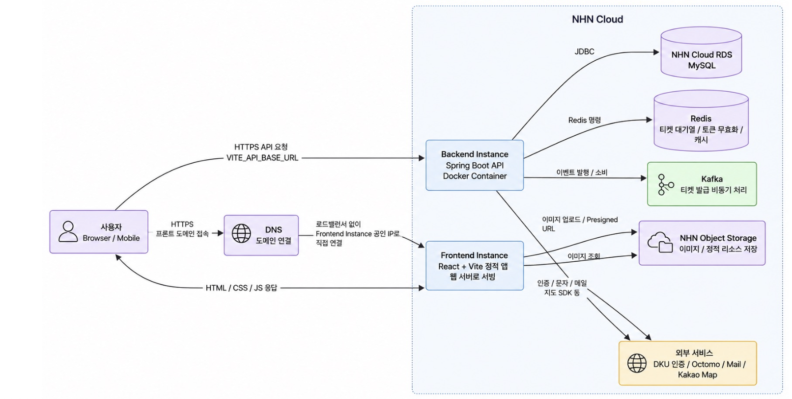

---

## 서비스 아키텍처

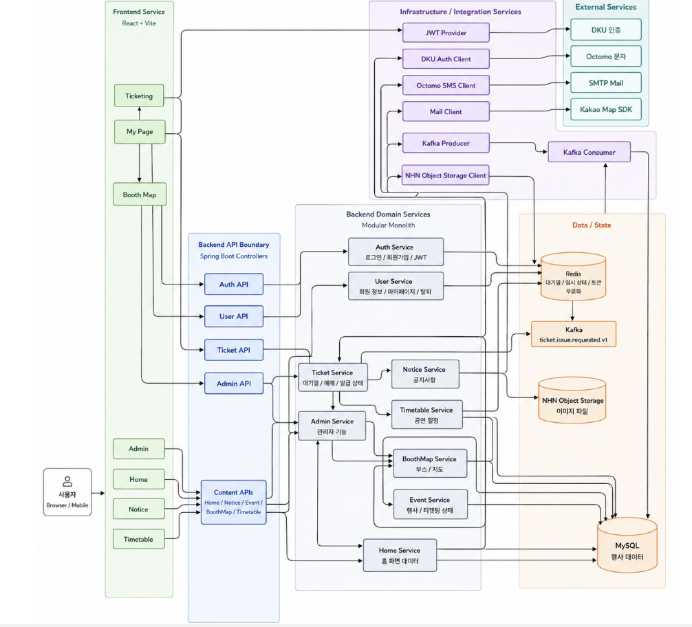

오픈 순간 수천 명(최대 10000명까지 테스트)이 동시에 들어오는 상황을 고려해서 설계했습니다.

---

## 실제 운영 결과

> 2026년 5월 7일 티켓팅 오픈 기준 실측 데이터

| | |
|---|---|
| 동시 접속자 | **4,500명** |
| 티켓 소진 시간 | **1분 만에 3,500장 전량 매진** |
| 중복 발급 / 순번 오류 | **ZERO** |
| CPU 사용률 | **약 40%** (16vCPU, 64GB 기준) |
| queue_enter 평균 응답속도 | **498ms** |
| 서버 Overflow | **0건** |

**트래픽 현황**

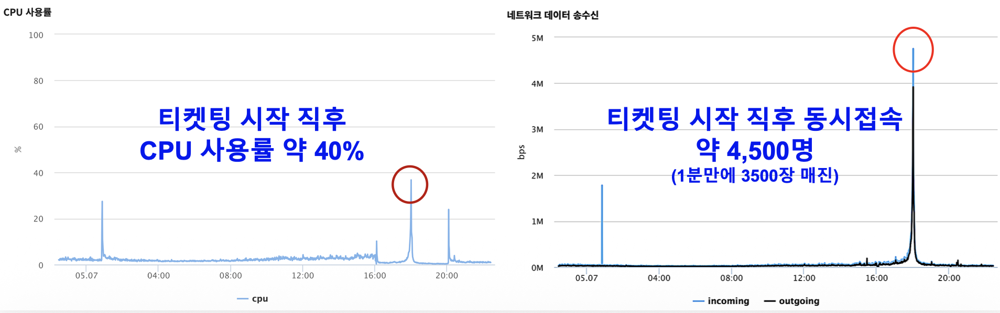

---

## 사용자 데이터

> 축제 기간 (5/10 – 5/14) 기능별 실제 사용 현황

<table>
<tr>
<td>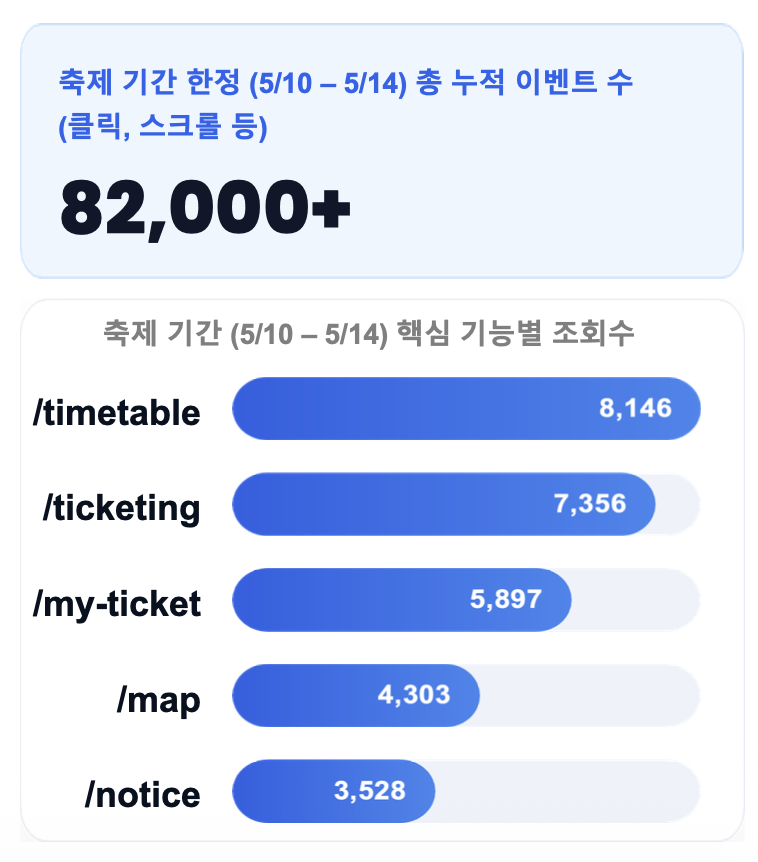</td>
<td>

| 기능 | 조회수 |
|---|---:|
| 타임테이블 | **8,146회** |
| 티켓팅 | **7,356회** |
| 내 티켓 | **5,897회** |
| 부스맵 | **4,303회** |
| 공지사항 | **3,528회** |

총 누적 이벤트 수 (클릭·스크롤 등) **82,000+**

</td>
</tr>
</table>

---

## 사용자 피드백

| | |
|:---:|:---:|
| 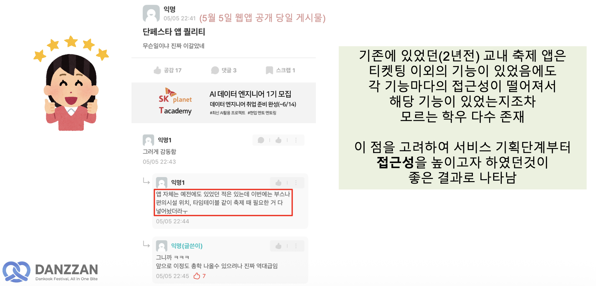 | 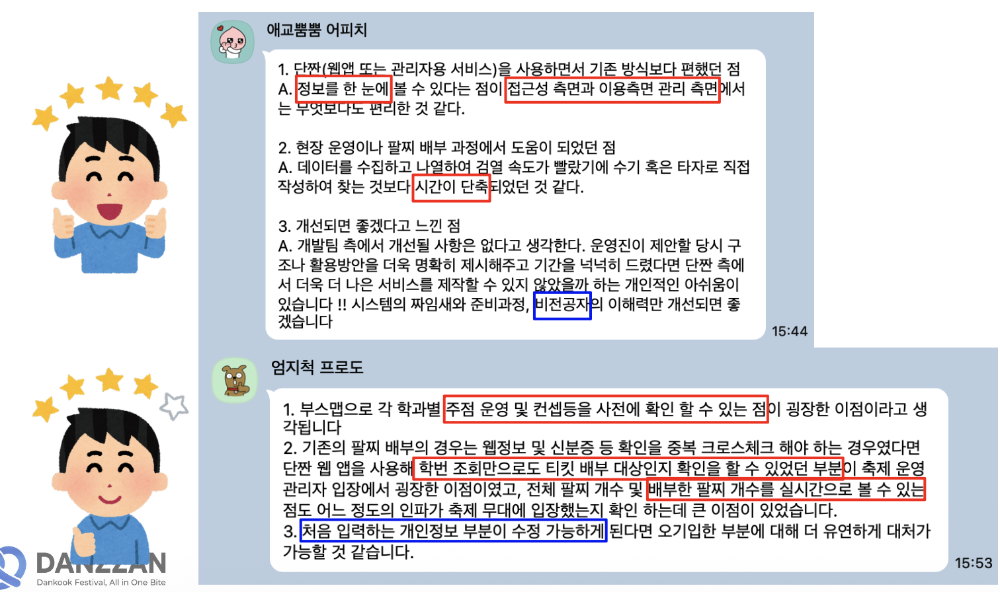 |
| 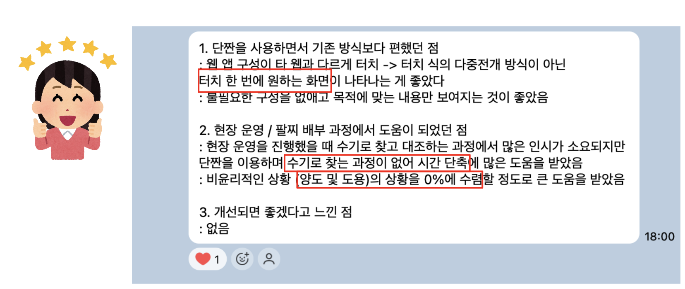 | 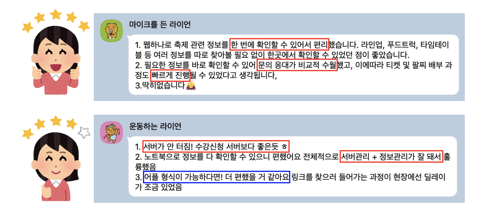 |

---

## 기대 효과

| | |
|:---:|---|
| **운영진 업무 효율화** | 티켓 발급, 팔찌 수령, 공지 수정 등 반복 업무를 단일 플랫폼에서 처리. 채널별 중복 게시와 개별 문의 대응 부담 감소 |
| **암표·양도 원천 차단** | 네이버 페이스사인 얼굴 인증으로 입장 시 신원 재확인. 대리 입장과 티켓 양도를 구조적으로 차단 |
| **사용자 편의성 향상** | 공연 정보, 예매, 부스 위치, 공지를 하나의 앱에서 제공. 채널을 옮겨 다니지 않아도 됨 |

## 확장 계획

| | |
|:---:|---|
| **챗봇 / RAG 도입** | 공지, 위치, 티켓 수령 방법 등 자주 묻는 질문을 AI가 자동 응답. 운영진 문의 대응 부담 추가 감소 |
| **네이버 페이스사인 정식 API 연동** | 현장 확인 시간 단축 및 외부인 접근 제한 강화 |
| **교내 행사 전반으로 확장** | 체육대회, 학과 행사, 동아리 박람회 등으로 적용 범위 확대. 단국대 축제를 시작으로 지속적으로 보완해 교내 행사 전반에 사용 가능한 플랫폼으로 발전 |

---

## 기술 스택

**Frontend**

**Backend**

**Infra**

